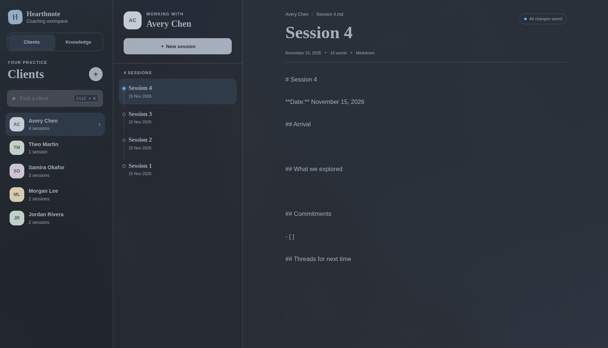

# Hearthnote

Hearthnote is a self-hosted coaching workspace for Markdown files. Use **Clients** to write session notes and **Knowledge** to browse educational materials and worksheet templates. The same files can be opened in Obsidian or synchronized with Syncthing.



## Try the demo

Run from the project directory with Python 3.11 or later. Hearthnote uses only the Python standard library and browser APIs.

```bash
python -m app.server
```

Or start it with Docker Compose:

```bash
docker compose up --build -d
```

Open [Hearthnote on localhost](http://localhost:8000). The included `synthetic_data` contains five fictional clients, five career-coaching notes, and four worksheet templates. Open **Knowledge** and use the folder menu to switch between **Educational materials** and **Worksheet bases**.

On first launch, create a username and password for Hearthnote’s single account. Use **Sign out** to end your session.

## Connect your coaching folder

Point Hearthnote at a folder with the following layout. Folder names can vary because you assign each folder a content type in Settings.

```text
Coaching/
  Clients/
    Client name/
      Session 1.md
  Educational materials/
    Career direction/
      What makes work a good fit.md
  Worksheet bases/
    Career direction/
      Career fit map.md
```

1. Open **Settings → Vault settings** using the gear next to **Vault connected**.
2. Set **Coaching root** to the absolute folder path. With the included Docker Compose setup, use `/vault`.
3. Choose a folder from **Browse folders**. Use **Open** to browse into a subfolder and **Add folder** to include a folder as **Clients** or **Knowledge**.
4. Select **Save settings**. You can add multiple folders per type, change a folder's type, or remove it from the workspace. Removing a folder from Settings leaves its files on disk.

Hearthnote suggests `Clients`, `Educational materials`, and `Worksheet bases` when it finds them. The older `Coaching notes/Client name/Session 1.md` layout works too. A typical Obsidian vault can be mounted directly if it contains a `Coaching` or `Coaching notes` folder.

When running Python directly, the default settings file is `~/.config/hearthnote/settings.json`. Set `NOTES_ROOT` to choose the initial folder and `CONFIG_PATH` to use a different settings file.

### Mount a folder in Docker

Set the host path when starting Compose:

```bash
HEARTHNOTE_VAULT_PATH="/absolute/path/to/Coaching" docker compose up --build -d
```

You can put that assignment in a local `.env` file to reuse it. Compose mounts the folder at `/vault`, keeps vault settings in the `hearthnote-config` volume, and keeps the account and login sessions in `hearthnote-data`. Keep both volumes when updating the container. If you switch from the demo to your vault and the previous selections still appear, select the folders in the new mount under **Vault settings**.

For a manually configured container or NAS, set the following mounts and environment variables:

| Mount | Access |
| --- | --- |
| Host coaching folder → `/vault` | Read/write for client notes |
| Persistent vault-settings folder → `/config` | Read/write |
| Persistent account-data folder → `/data` | Read/write |

```dotenv
NOTES_ROOT=/vault
VAULT_BOUNDARY=/vault
CONFIG_PATH=/config/settings.json
HEARTHNOTE_DATA_DIR=/data
```

The supplied Compose file uses the `:Z` suffix for SELinux labeling.

### TrueNAS and HexOS app icon

The [Hearthnote app icon](app/static/app-icon.png) is a 256 × 256 PNG with the same H mark as the app header and browser favicon. Hearthnote serves it at `/app-icon.png`. Use the full URL on your NAS, for example `http://nas-host:8000/app-icon.png`, or use an HTTPS URL reachable by the dashboard.

- **TrueNAS** reads a custom app's tile icon from `metadata.icon`. For an existing custom YAML installation, add or replace only the `icon` entry under `metadata` in `/mnt/.ix-apps/app_configs/<app-name>/metadata.yaml`. Then save the app through **Apps → Installed → Hearthnote → Edit** to reload its metadata, and refresh the Apps page. This is a TrueNAS-side customization. [Custom app icon example](https://jellyfin.org/docs/general/installation/advanced/truenas/#adding-the-jellyfin-logo-to-custom-apps)
- **HexOS** custom install scripts and catalog entries supply their icon through `metadata.icon`. Use the same PNG as the script's icon asset. An existing app installed through TrueNAS gets its icon from the NAS app metadata where the Command Deck uses it. [HexOS app metadata example](https://github.com/eshtek/hexos-app-catalog/blob/main/kodi.json)

## Use the workspace

- **Clients** shows searchable client folders, numbered sessions, and an **Other notes** list for Markdown files such as intake forms. Open a note in **Read** mode or switch to **Edit** to change its Markdown. Changes autosave, and Hearthnote flags edits made outside the app. Hearthnote creates the next numbered session and accepts names such as `Session 1.md` and `session1.md`. Long client names wrap to two lines, then show an ellipsis; hover to see the full name.
- **Knowledge** shows topics, materials, and a read-only Markdown reader. Each folder containing Markdown files, including nested folders, becomes a topic. Files at the source root appear under **General**. Search matches topic names and material titles. The reader renders headings, lists, checklists, tables, quotes, and code blocks.
- **Keyboard shortcuts** use `Ctrl+K` or `⌘K` for search and `Ctrl+S` or `⌘S` to save a client note. On mobile, use the back buttons to move between columns.

## Appearance

Use the sun, moon, or circled **A** next to **Settings** to switch between **Light**, **Dark**, and **Auto**. In **Settings → Appearance**, choose the Light and Dark palettes for **Clients** and **Knowledge** independently. The original Hearthnote light palettes and 12 VS Code-inspired options are available, with previews and soft gradients.

Under **Auto mode location**, let the browser detect your location or enter latitude and longitude manually. Auto uses that location's sunrise and sunset. With no location set, it uses light mode from 07:00 until 19:00 in device time. Coordinates and preferences are stored in this browser. The manual option also works when browsers restrict geolocation on an HTTP NAS installation. [Solar position equations](https://gml.noaa.gov/grad/solcalc/solareqns.PDF)

Use **Keyboard shortcut hints** in the same tab to choose **Automatic**, **Mac (⌘)**, or **PC (Ctrl)**. Appearance changes apply immediately.

Palette sources include [One Dark Pro](https://github.com/Binaryify/OneDark-Pro), [Dracula](https://draculatheme.com/contribute), [GitHub Dark and Light Default](https://github.com/primer/github-vscode-theme), [Night Owl](https://github.com/sdras/night-owl-vscode-theme), [Tokyo Night](https://github.com/tokyo-night/tokyo-night-vscode-theme), [Catppuccin Mocha and Latte](https://github.com/catppuccin/catppuccin), [Gruvbox Dark](https://marketplace.visualstudio.com/items?itemName=jdinhlife.gruvbox), [Nord](https://www.nordtheme.com/docs/colors-and-palettes/), [Monokai](https://github.com/microsoft/vscode/tree/main/extensions/theme-monokai), and [Solarized Light](https://github.com/microsoft/vscode/tree/main/extensions/theme-solarized-light).

## Privacy and deployment

Complete first-run account setup on a trusted network: anyone who can reach the server before setup can claim the account. Direct Python runs listen on loopback by default and store account data in `.hearthnote/` next to the app; set `HEARTHNOTE_DATA_DIR` to use a different directory outside your vault.

Compose publishes port 8000 on all host interfaces by default. For local-only access, change the mapping to `127.0.0.1:8000:8000`. For remote access, use an HTTPS reverse proxy that preserves the incoming `Host` header, set `HEARTHNOTE_SECURE_COOKIE=1`, and restrict direct access to the app port. Keep real vaults and backups outside the repository; the included demo notes are fictional.

## Tests

```bash
python -m unittest discover -s tests -v
```

## License

Hearthnote is licensed under the **GNU General Public License, version 3 only** (`GPL-3.0-only`). See [LICENSE](LICENSE) for the full license text.
